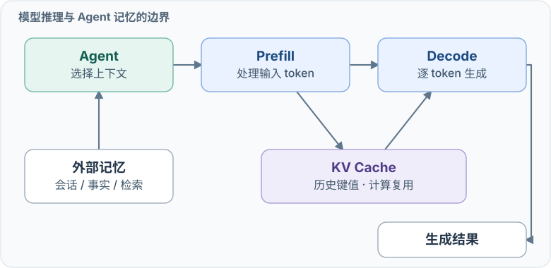

# 模型与推理：把 LLM 当作概率计算服务

::: tip 本课目标
模型不是数据库，也不是业务规则引擎。它根据上下文预测后续 token；推理服务负责执行模型计算，Agent 则负责决定何时调用模型和如何使用结果。
:::

## 1. 原理与边界

传统接口相同输入通常要求相同语义结果；LLM 即使温度为零也不能保证跨版本、硬件和服务实现完全可复现。输入 token 决定预填充成本，输出 token 影响逐 token 解码时间。KV Cache 保存注意力计算所需的历史键值，通常位于推理设备显存或分层缓存中，不是 Agent 的用户记忆。

*图：KV Cache 属于推理过程中的计算缓存；跨会话事实由 Agent 的外部记忆系统负责。*

## 2. 贯穿项目中的例子

工单“数据库连接失败”可以被模型分类，但服务真实状态必须从监控工具查询。把事实查询交给工具，把语义理解交给模型。记录 model、input_tokens、output_tokens、TTFT、总延迟。

## 3. 动手实验

固定 10 条工单，分别用简短上下文和附加长日志请求模型；每条重复 3 次。对比分类准确率、TTFT、token 和成本。日志去除密钥。

先建立可运行基线，保存输入、日志、版本与失败样本，再进行对照实验。输出记录可采用[实验模板](../../guide.md)。

## 4. 验收标准

解释预填充、解码、KV Cache、上下文窗口与会话存储的区别；给出一次真实或模拟调用的成本与延迟表。

## 5. 定向阅读

- [参考资料](https://developers.openai.com/tracks/building-agents)：Model 调用与 orchestration。

阅读后用自己的实现解释设计取舍，而不是抄写 API。
