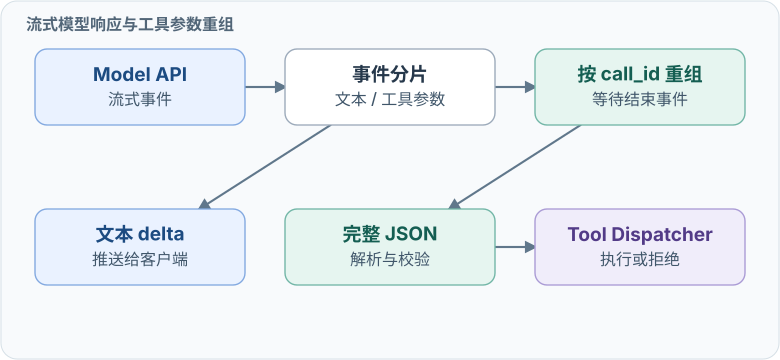

# 模型 API、流式输出与适配层

::: tip 本课目标
将供应商 API 隔离在 ModelAdapter 中，避免业务代码直接依赖特定模型响应结构。
:::

## 1. 原理与边界

接口至少需要 request(messages, tools, deadline) 和 stream(request)。流式 delta 不是完整消息：工具参数可能分片，只有结束事件后才能解析。区分首 token 延迟、流结束延迟和端到端任务延迟；客户端断线应传递取消信号，不能默默继续消耗预算。

*图：流式 delta 先累积，工具参数完整后才解析、校验和执行。断线或超时要传播取消。*

## 2. 贯穿项目中的例子

使用内部事件 text_delta、tool_call_delta、completed、failed。服务端生成 run_id 和 seq；客户端按序消费。遇到 429 尊重 Retry-After，退避并限制总 deadline，已产生副作用的请求不要盲目重试。

## 3. 动手实验

实现一个 fake adapter，分三段返回 JSON 工具参数，并模拟中途断线。再替换真实适配器；记录取消前后任务状态。

先建立可运行基线，保存输入、日志、版本与失败样本，再进行对照实验。输出记录可采用[实验模板](../../guide.md)。

## 4. 验收标准

能够解释为什么不能逐段执行工具；测试断线、超时、供应商限流和流式重组。

## 5. 定向阅读

- [参考资料](https://platform.openai.com/docs/guides/streaming-responses)：Streaming events。

阅读后用自己的实现解释设计取舍，而不是抄写 API。
