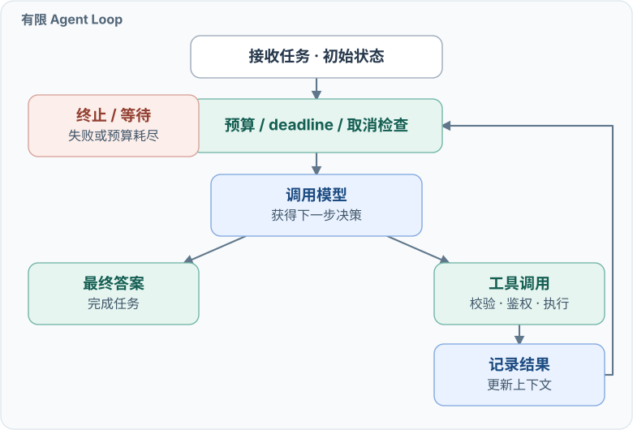

# Agent Loop、工作流与终止条件

::: tip 本课目标
Agent Loop 是模型决策、工具执行、结果反馈的循环；并不意味着无限自主运行。
:::

## 1. 原理与边界

可预先确定步骤时优先确定性 workflow；开放任务才需要模型动态选择。每轮必须检查 deadline、最大步数、token 预算、取消状态。终止可能是成功、不可恢复错误、等待人工审批、预算耗尽。多工具并行仅适合无依赖且安全的操作。

*图：每轮先检查预算和取消状态；工具结果反馈到下一轮。模型给出最终答案、预算耗尽或审批等待都可结束当前执行。*

## 2. 贯穿项目中的例子

工单任务：先检查服务状态，若异常则查询知识库，给出建议；需要写工单时等待人工批准。最小循环见 labs/runtime.py，使用 fake model 验证执行逻辑。

## 3. 动手实验

执行 python -m unittest discover -s labs -v；构造模型永远请求同一工具的场景，确认循环停止。再添加预算限制和错误反馈测试。

先建立可运行基线，保存输入、日志、版本与失败样本，再进行对照实验。输出记录可采用[实验模板](../../guide.md)。

## 4. 验收标准

不依赖 Agent 框架解释并实现一个有限循环；用测试证明重复调用和非法工具不会无限运行。

## 5. 定向阅读

- [参考资料](https://www.anthropic.com/research/building-effective-agents)：工作流与 Agent 的区别，路由、并行、编排模式。

阅读后用自己的实现解释设计取舍，而不是抄写 API。
