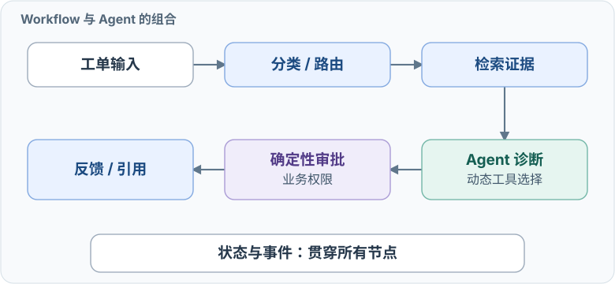

# 从手写循环到框架与工作流

::: tip 本课目标
框架的价值是可复用的运行机制，不是替代系统设计。先用一个框架构建应用，再研究内部实现。
:::

## 1. 原理与边界

Agents SDK 提供运行、工具、会话和追踪抽象；LangGraph 强调图、状态和持久化。对已知路径用明确节点，对不确定子任务使用 Agent。明确每个节点的输入输出和副作用，避免所有逻辑都塞进一个 prompt。

*图：确定性流程约束业务路径；只有开放任务交给 Agent 动态决策，权限和审批仍由程序控制。*

## 2. 贯穿项目中的例子

工单流程：分类 → 检索 → 诊断 → 审批 → 反馈。分类可用模型，权限和审批必须确定性实现。用图状态保存 ticket_id、evidence_ids、approval_status。

## 3. 动手实验

分别用手写循环和任选一个框架实现相同流程，固定测试样本。比较代码量、调试难度、状态恢复及错误处理；不要仅比较 demo 行数。

先建立可运行基线，保存输入、日志、版本与失败样本，再进行对照实验。输出记录可采用[实验模板](../../guide.md)。

## 4. 验收标准

能解释为什么选某框架以及不用它的代价；展示失败节点如何定位和重跑。

## 5. 定向阅读

- [参考资料](https://academy.langchain.com/)：LangGraph 状态、持久化、中断。

阅读后用自己的实现解释设计取舍，而不是抄写 API。
