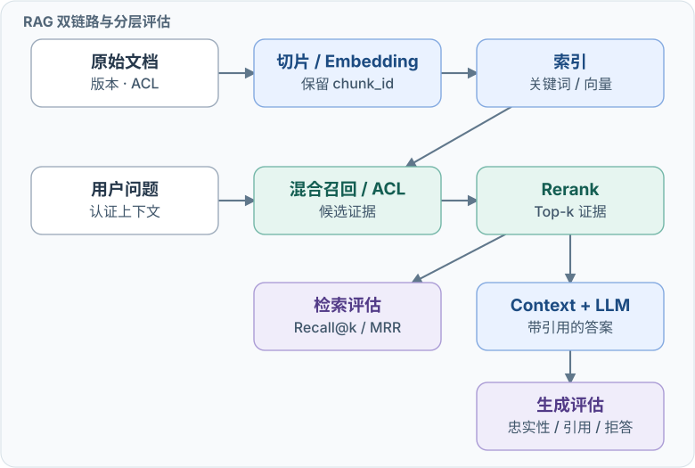

# RAG：从检索基线到可测优化

::: tip 本课目标
RAG 的关键是将检索质量与回答质量分开测量。
:::

## 1. 原理与边界

数据摄取需保留 doc_id、版本、ACL、chunk_id。索引阶段做切片与向量化；查询阶段可用关键词、向量混合召回、rerank、组装证据。检索阶段计算 Recall@k、MRR 等，生成阶段检测引用正确性、忠实性和拒答。ACL 必须在检索或返回前强制执行。

*图：离线索引与在线检索分开；检索质量和答案质量分别评估，并在证据返回前执行 ACL。*

## 2. 贯穿项目中的例子

创建 30 篇虚拟运维手册和 30 个带相关 chunk 标注的问题。用简单关键词检索作为 baseline，再添加 embedding 和 rerank；对于无答案问题要求明确不确定。

## 3. 动手实验

固定 k 和数据版本，逐项调整 chunk size、top-k、混合权重、rerank；记录 Recall@5、P95、token 成本和错误例。不要同时改变所有参数。

先建立可运行基线，保存输入、日志、版本与失败样本，再进行对照实验。输出记录可采用[实验模板](../../guide.md)。

## 4. 验收标准

提交检索与生成两份评估表，定位一次检索失败到底来自切片、召回还是重排。

## 5. 定向阅读

- [参考资料](https://github.com/DataTalksClub/llm-zoomcamp)：RAG、vector search、evaluation、monitoring。

阅读后用自己的实现解释设计取舍，而不是抄写 API。
