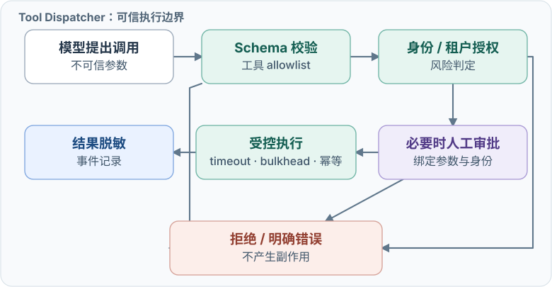

# Tool Dispatcher：校验、权限与副作用

::: tip 本课目标
Dispatcher 是模型意图到真实执行之间的可信边界。
:::

## 1. 原理与边界

顺序为 schema 校验 → 身份/租户授权 → 风险判定 → 审批 → timeout/bulkhead → 幂等执行 → 结果脱敏 → 事件记录。读取和写入工具策略不同；只有可安全重试的错误才自动重试。外部写成功但响应丢失时，先查状态或使用 idempotency key。

*图：模型只能提出工具意图；校验、授权、审批、超时和幂等由程序执行。任一检查不通过即拒绝，不接触真实工具。*

## 2. 贯穿项目中的例子

create_ticket 通过唯一键 (tenant_id, operation_id) 去重。审批绑定工具名、规范化参数哈希及有效期，修改参数后重新审批。禁止模型传入任意 URL 或命令。

## 3. 动手实验

设计五种错误：unknown_tool、invalid_args、denied、timeout、upstream_error；模拟写成功后响应丢失，重复请求不得生成第二张工单。

先建立可运行基线，保存输入、日志、版本与失败样本，再进行对照实验。输出记录可采用[实验模板](../../guide.md)。

## 4. 验收标准

提交 dispatcher 契约、权限测试、重试分类和副作用去重证据。

## 5. 定向阅读

- [参考资料](https://www.anthropic.com/engineering)：Writing effective tools for agents。

阅读后用自己的实现解释设计取舍，而不是抄写 API。
