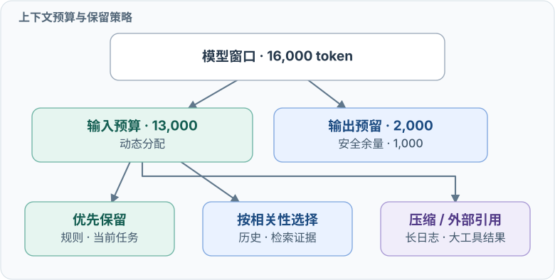

# Context Manager：预算、裁剪和压缩

::: tip 本课目标
Context Engineering 要把信息选择作为显式策略，而不是无边界地拼接字符串。
:::

## 1. 原理与边界

可用预算 = 模型上限 − 输出预留 − 安全余量。按重要性分配系统、当前任务、历史、证据、工具结果。摘要会丢失细节；保留结构化事实、引用、未完成任务和工具调用配对。对大工具输出使用外部存储与引用。利用前缀稳定性优化缓存，但不能牺牲权限隔离。

*图：假设模型上限为 16,000 token，预留输出与安全余量后，输入预算为 13,000。各信息类别的分配需由任务和实验决定。*

## 2. 贯穿项目中的例子

上下文预算假设 16000 token，预留输出 2000 和余量 1000，实际可用 13000。系统规则固定；当前任务优先；对日志做摘要而非截断半个 JSON。

## 3. 动手实验

写 ContextBuilder，记录每段 token 估计与被裁剪原因。使用 30 轮更正实验，比较裁剪、摘要、检索；报告丢失事实率、输入 token 与缓存命中。

先建立可运行基线，保存输入、日志、版本与失败样本，再进行对照实验。输出记录可采用[实验模板](../../guide.md)。

## 4. 验收标准

预算越界可控；工具结果与调用匹配；能重现一次压缩造成的任务失败并修复。

## 5. 定向阅读

- [参考资料](https://www.anthropic.com/engineering)：Effective context engineering for AI agents。

阅读后用自己的实现解释设计取舍，而不是抄写 API。
