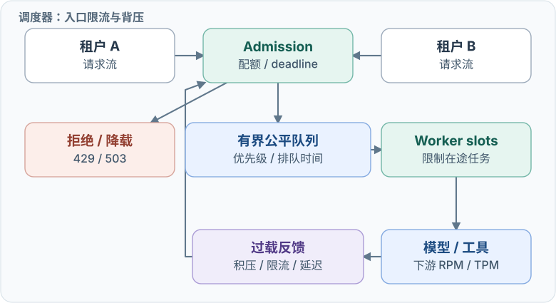

# 任务调度、背压与公平性

::: tip 本课目标
当到达率超过服务率，队列必然增长；调度器必须保护平台而不是默默积压。
:::

## 1. 原理与边界

区分 admission control、队列、worker slots 和下游限额。有限队列满时明确返回 429/503 或等待入队，设置 deadline。采用每租户并发配额、加权公平队列，防止大租户独占。重试进入预算并增加 jitter，避免重试风暴。Little 定律 L=λW 只适用于稳定且口径一致的系统。

*图：队列必须有容量限制；租户配额、worker slots 和供应商限额共同决定系统的有效吞吐。*

## 2. 贯穿项目中的例子

100 QPS、平均 run 30 秒，稳定时平均 3000 个在途 run；若每 run 平均 5 次模型调用，平均需求 500 calls/s，不代表 3000 个线程。若供应商限额 300 calls/s，需要限流或降载。

## 3. 动手实验

模拟突发 2 倍流量，比较无界队列、有限 FIFO、租户配额；用固定服务时间和长尾服务时间分别测试。记录接受率、拒绝率、排队时间、完成率、租户饥饿。

先记录基线、环境和失败样本，再做控制变量实验。使用[实验模板](../../guide.md)保存结论。

## 4. 验收标准

实现有界 admission 和独立下游并发限制；用数据解释为何单纯扩容 worker 无法解除供应商限额。

## 5. 定向阅读

- [参考资料](https://sre.google/sre-book/handling-overload/)：过载保护、队列、负载削减。

将阅读内容映射到自己的系统，明确哪些机制可以复用、哪些需要验证。
