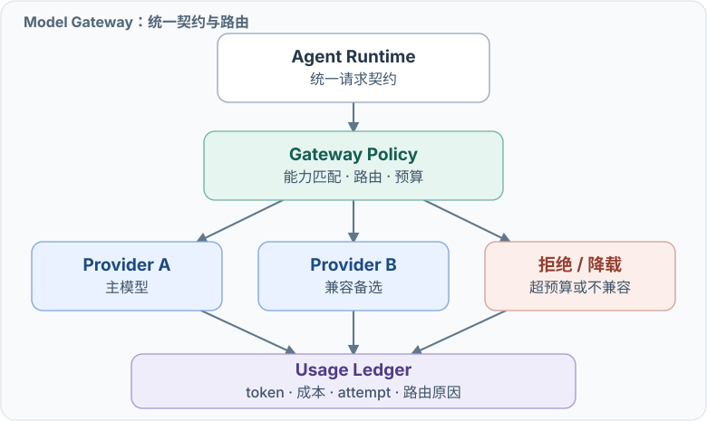

# Model Gateway：路由、限流、预算和成本

::: tip 本课目标
网关隔离供应商差异，让 Agent Runtime 使用统一契约；不能把语义差异简单抹平。
:::

## 1. 原理与边界

定义 capability registry（tool calling、structured output、context limit、streaming）、route policy、retry policy、usage ledger。限额可能同时按请求和 token 计算；按租户预留预算并在响应后结算。fallback 只在兼容能力和任务风险允许时启用，不能在输出流已交付后静默切换模型。

*图：路由前检查能力、预算与配额；只有在兼容且未产生不可逆输出时才能按策略降级或切换模型。*

## 2. 贯穿项目中的例子

工单分类路由到便宜模型，复杂诊断路由到强模型。若返回 429，退避并考虑兼容备选；记录 provider、model、attempt、token、费用和 fallback 原因。价格表带日期和币种。

## 3. 动手实验

构造两个 fake provider，分别注入 429、5xx、慢响应和不支持工具；实现 token bucket、预算账本与 circuit breaker。比较固定路由和策略路由的成功率、延迟与成本。

先记录基线、环境和失败样本，再做控制变量实验。使用[实验模板](../../guide.md)保存结论。

## 4. 验收标准

所有失败路径遵守 deadline；超预算不可发起调用；路由决策可追溯；不泄露不同租户密钥。

## 5. 定向阅读

- [参考资料](https://docs.temporal.io/ai/cookbook)：LiteLLM 切换模型、HTTP retry policy。

将阅读内容映射到自己的系统，明确哪些机制可以复用、哪些需要验证。
