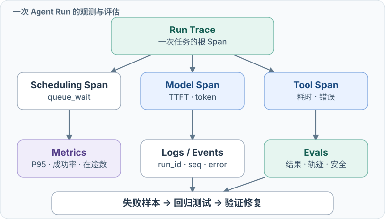

# 可观测性、评估与 SLO

::: tip 本课目标
必须同时观测系统健康和 Agent 任务质量；HTTP 200 可能对应任务失败。
:::

## 1. 原理与边界

Trace 以 run 为根，模型、工具、检索、调度为 span；跨异步队列传播 context。Metrics 建议 run_success_rate、queue_wait、TTFT、run_duration、tool_errors、tokens、inflight。不要将 run_id 或 user_id 放在高基数指标标签；详细标识进入权限受控日志。采样、脱敏、保留期与追踪费用也要设计。

*图：Trace 解释时间花在哪里；Metrics 描述系统总体表现；Evals 判断任务和轨迹是否正确。三者通过 run_id 在受控日志中关联。*

## 2. 贯穿项目中的例子

教学 SLO：只读工单 95% 在 30 秒内成功且引用正确。分开衡量模型等待、调度等待、工具耗时、输出验证。写操作安全违规单独告警，不用平均值掩盖风险。

## 3. 动手实验

接入 OpenTelemetry 或先用 JSON span；注入模型慢响应和数据库慢查询，从 trace 确认耗时归属；做失败样本的 trace → eval → regression 关联。

先记录基线、环境和失败样本，再做控制变量实验。使用[实验模板](../../guide.md)保存结论。

## 4. 验收标准

提供一个完整 run 的 trace、指标看板或数据表、告警规则；解释 SLI、SLO、error budget 的差异。

## 5. 定向阅读

- [参考资料](https://opentelemetry.io/docs/)：Trace、metrics、context propagation；结合 Google SRE Monitoring。

将阅读内容映射到自己的系统，明确哪些机制可以复用、哪些需要验证。
