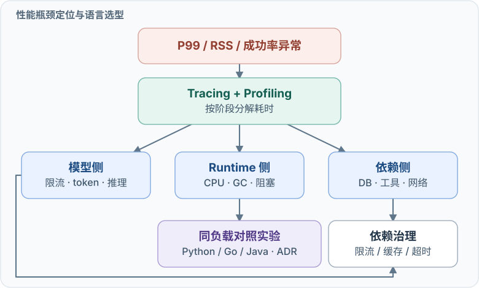

# 性能工程与语言技术选型

::: tip 本课目标
语言选择应建立在实际瓶颈、吞吐目标、团队成本和生态适配上，而非简单的跑分排名。
:::

## 1. 原理与边界

先分解 latency：排队、context 构造、模型推理、工具、持久化、输出。再看资源：CPU、RSS、GC、event loop lag、连接数、GPU 或 API 限额。比较 Python/Go/Java 时使用同一协议、负载、机器、并发限制和模型模拟服务；避免把外部模型波动当语言差异。闭环负载可能掩盖排队，使用固定到达率并报告拒绝和超时。

*图：先测耗时和资源，再定位热点。仅当运行时自身是主要瓶颈且替代方案经同负载实验验证时，才考虑重写关键组件。*

## 2. 贯穿项目中的例子

分别运行 Python asyncio 和已有 Java/Go 的 worker 原型，模拟 200ms I/O 与 20ms CPU 两种工作负载，逐级提高到达率。比较吞吐、P50/P95/P99、RSS、CPU、成功率和维护复杂度。

## 3. 动手实验

至少预热一次、重复三次，保持环境一致；报告测试时长、样本数、分布、饱和点和误差。先用 profiler 定位热点，再优化；记录 ADR：保留单体、拆 worker 或重写关键组件。

先记录基线、环境和失败样本，再做控制变量实验。使用[实验模板](../../guide.md)保存结论。

## 4. 验收标准

必须提交 baseline、原始数据、瓶颈证据和前后对比；不能仅因 Python 慢而选择重写。

## 5. 定向阅读

- [参考资料](https://grafana.com/docs/k6/latest/)：Scenarios、arrival-rate、thresholds。

将阅读内容映射到自己的系统，明确哪些机制可以复用、哪些需要验证。
