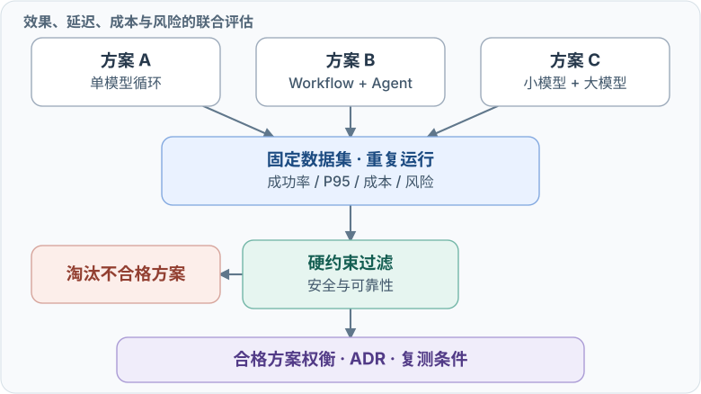

# Agent 效果、成本与性能的联合优化

::: tip 本课目标
单一指标优化可能伤害整体目标；目标应是满足安全和可靠性约束下的任务价值。
:::

## 1. 原理与边界

建立 quality、latency、cost、risk 的多目标评价；固定数据集和基线，分层比较正常、复杂、无答案及恶意输入。优化顺序由证据决定：减少无用模型调用、并行独立工具、上下文预算、缓存、路由，再考虑运行时重构。缓存必须尊重版本、租户和时效。

*图：用相同数据集比较方案，先淘汰不满足安全与可靠性硬约束的候选，再依据质量、成本、延迟的权衡作出决策。*

## 2. 贯穿项目中的例子

比较三种方案：A 单模型循环，B 确定性 workflow + Agent fallback，C 小模型分类 + 大模型诊断。用相同工单集重复运行，报告任务成功率、P95、成本、拒答和安全指标；选择满足约束的 Pareto 方案。

## 3. 动手实验

使用至少 50 条样本，保留失败案例。每个方案记录模型版本、prompt、工具和成本估算，随机或固定顺序运行，讨论样本不确定性。

先记录基线、环境和失败样本，再做控制变量实验。使用[实验模板](../../guide.md)保存结论。

## 4. 验收标准

提交多方案对照与 ADR；明确什么条件下会改变当前选型，避免只给出最优单点。

## 5. 定向阅读

- [参考资料](https://www.anthropic.com/engineering)：Demystifying evals for AI agents；Context 与 Harness 相关案例。

将阅读内容映射到自己的系统，明确哪些机制可以复用、哪些需要验证。
